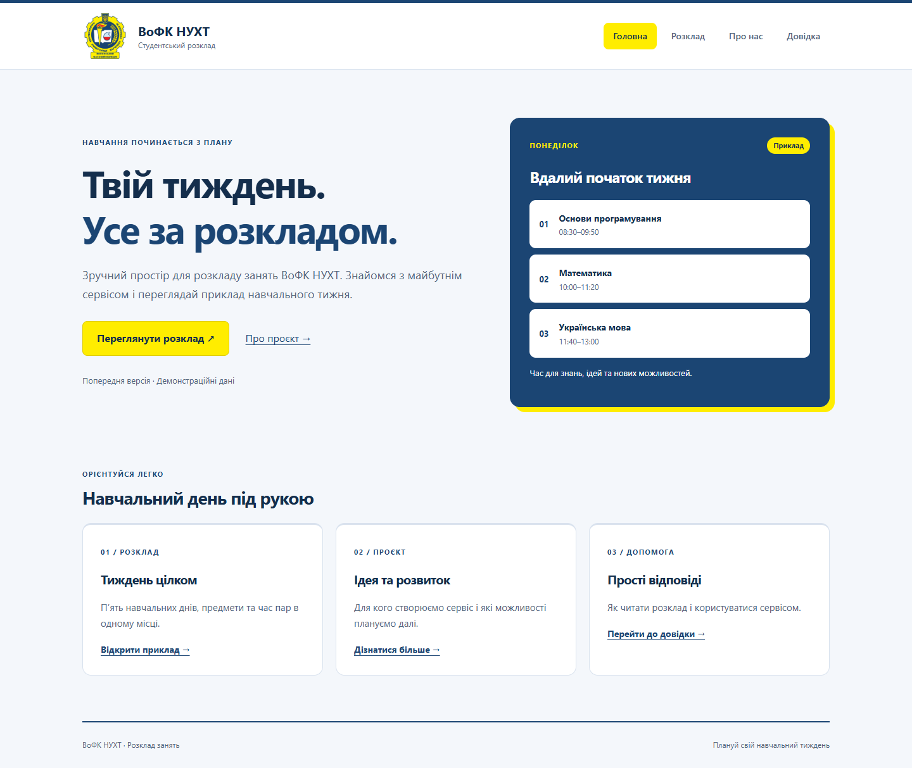
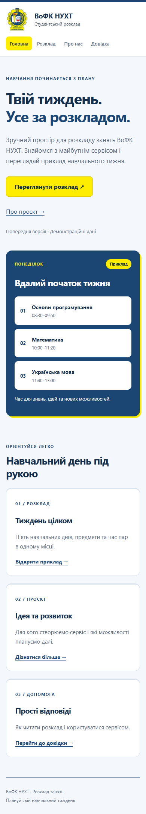
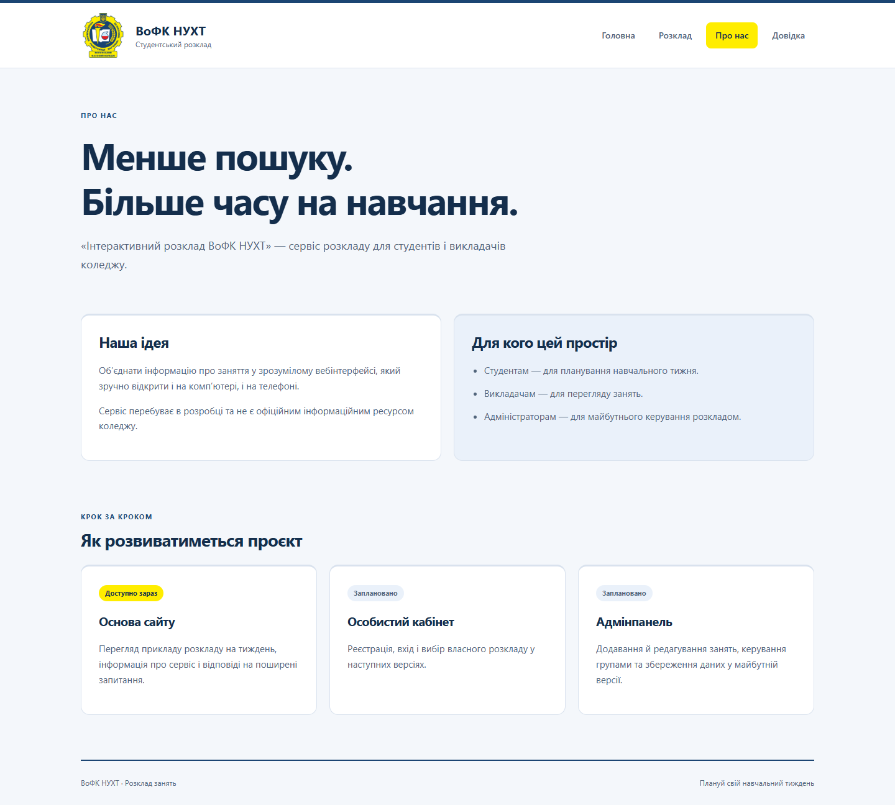
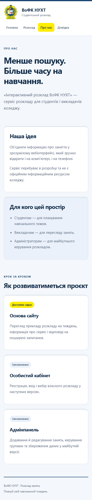
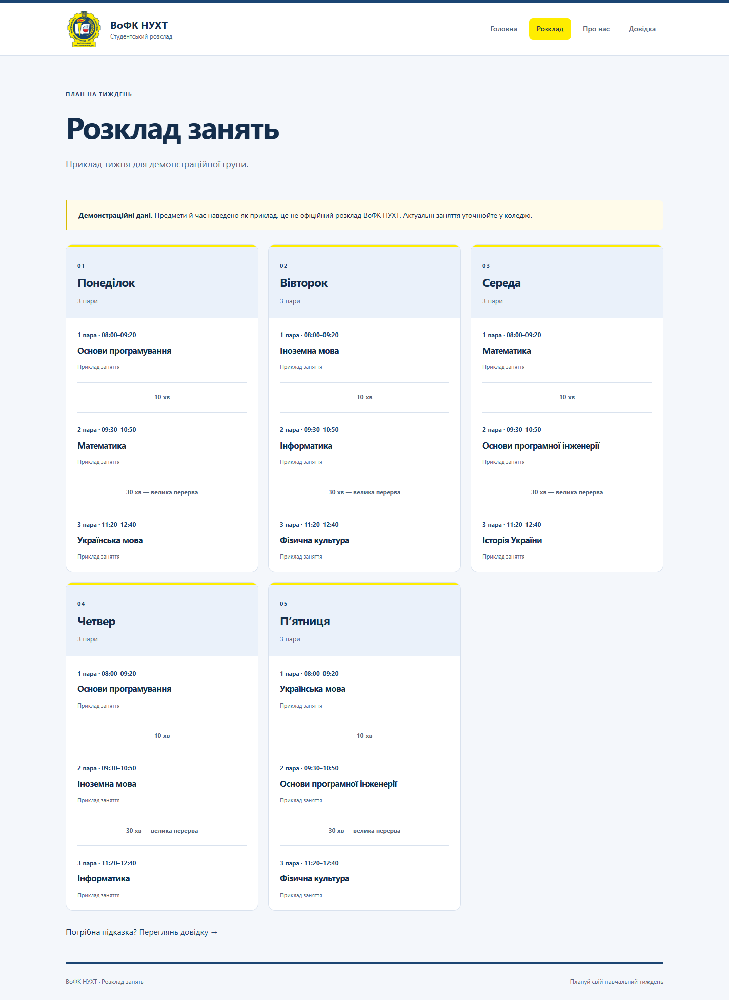
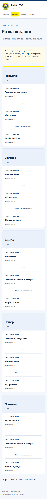
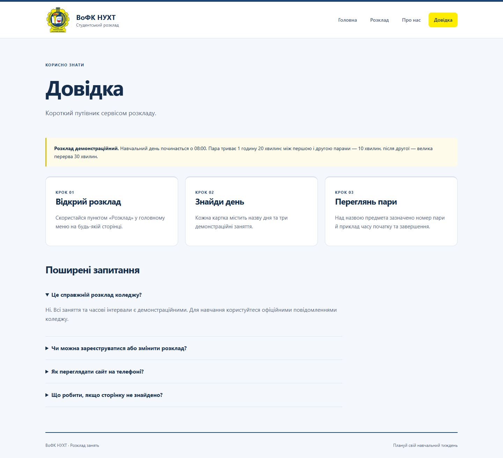
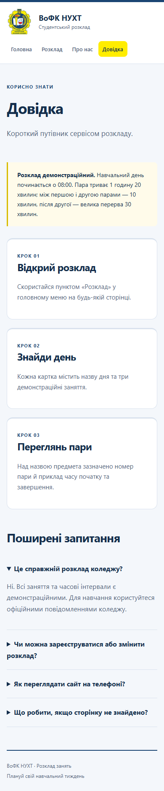

# Звіт до лабораторної роботи №3

**Тема роботи:** Розробка базового вебпроєкту.

## 1. Відомості про автора та проєкт

| Відомості | Значення |
| --- | --- |
| ПІБ | Максим Яцків |
| Група | ІПЗ 21 |
| Склад команди | Максим Яцків |
| Предметна область | Інтерактивний розклад занять ВоФК НУХТ |
| Репозиторій | [Natl1x/vofknuht-schedule](https://github.com/Natl1x/vofknuht-schedule) |

Мета проєкту — створити основу вебсервісу для перегляду розкладу занять студентами та викладачами коледжу. Поточна версія містить статичні демонстраційні дані; реєстрація та керування розкладом належать до подальшого розвитку.

## 2. Особистий внесок

Максим Яцків відповідав за всі компоненти проєкту. Код і документацію підготовлено за допомогою Codex.

| Частина роботи | Результат |
| --- | --- |
| Серверна частина | Застосунок Flask, маршрути /, /about, /schedule, /help та обробник помилки 404 |
| Сторінки | Головна, «Про нас», дві додаткові статичні сторінки «Розклад» і «Довідка» |
| Шаблони | Спільний base.html, наслідування Jinja2, меню через url_for та виділення поточної сторінки |
| Оформлення | Логотип коледжу, синьо-жовта палітра, CSS Grid і медіазапити для вузьких екранів |
| Перевірка | Три автоматичні тести: сторінки й посилання; вміст розкладу; CSS та відповідь 404 |
| Документація | Інструкція запуску, залежності, цей звіт і скріншоти сторінок |

[Коміт поточної версії проєкту](https://github.com/Natl1x/vofknuht-schedule/commit/7cf2d9f). Зміни об’єднано в один коміт.

Застосунок запускається командою `.venv\Scripts\python.exe main.py` та доступний за адресою `http://127.0.0.1:5000`. Перевірка: `.venv\Scripts\python.exe -m unittest discover -s tests -v`.

## 3. Скріншоти створених сторінок

Для кожної сторінки наведено звичайний вигляд (1440 px) і мобільний вигляд (390 px). Знімки містять сторінки повністю, від шапки до підвалу; довжина визначається кількістю вмісту. Мобільний розклад довший, оскільки п’ять карток днів розташовано в одну колонку.

### 3.1. Головна

**Звичайний вигляд.** Загальна інформація про сервіс, приклад дня та переходи до інших сторінок.

**Мобільний вигляд.** Блоки розташовано послідовно, меню доступне над основним вмістом.

### 3.2. Про нас

**Звичайний вигляд.** Мета сервісу, цільова аудиторія та заплановані можливості.

**Мобільний вигляд.** Інформаційні картки перебудовано в одну колонку.

### 3.3. Розклад

**Звичайний вигляд.** П’ять днів із трьома демонстраційними парами в кожному. Перша пара починається о 08:00, триває 1 год 20 хв; перерви становлять 10 хв і 30 хв після другої пари.

**Мобільний вигляд.** Усі п’ять днів показано послідовно, без обрізання останніх карток.

### 3.4. Довідка

**Звичайний вигляд.** Інструкція перегляду розкладу та відповіді на поширені запитання.

**Мобільний вигляд.** Кроки й запитання залишаються читабельними на вузькому екрані.

## 4. Труднощі та їх вирішення

| Труднощі | Рішення |
| --- | --- |
| Однакові меню й підвал потрібні на всіх сторінках | Спільну структуру винесено в base.html, список пунктів меню передається через context_processor |
| Розклад має залишатися читабельним на вузькому екрані | Використано CSS Grid та медіазапити; картки перебудовуються в одну колонку, меню переноситься |
| Запущений сервер показував попередню версію шаблонів | Сервер перезапущено, перевірено HTML-відповіді всіх чотирьох маршрутів |
| Початкові скріншоти мали зайвий порожній простір через фіксовану висоту | Знімки оновлено з урахуванням фактичної висоти вмісту та перевірено повноту сторінок |

## 5. Висновки

Створено вебзастосунок Flask із головною сторінкою, сторінкою «Про нас» та двома додатковими статичними сторінками. Спільні шаблони Jinja2 і адаптивний CSS забезпечують узгоджене оформлення та зручний перегляд на різних екранах. Отримана структура є основою для подальшого додавання реєстрації та керування розкладом.
